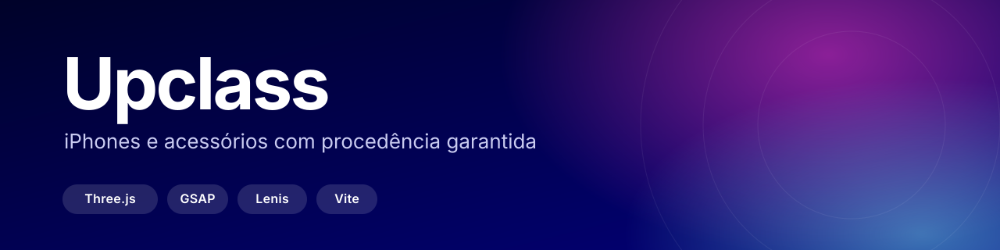
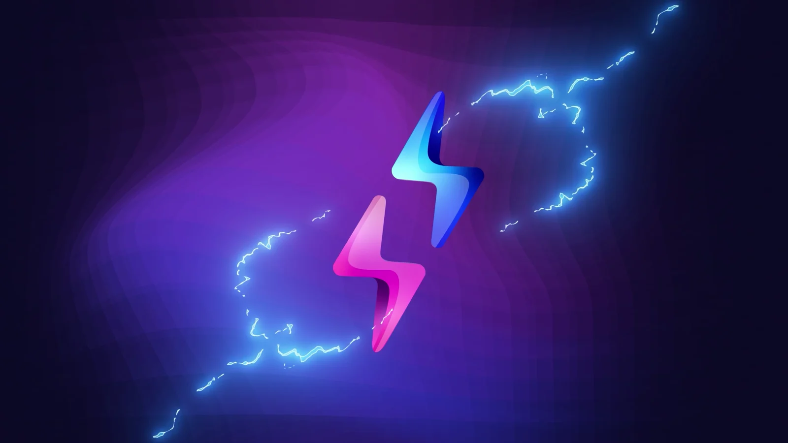

<div align="center">



<br>

<a href="https://upclass-beta.vercel.app/"></a>


<br>

<sub>

**[Sobre](#-sobre)** &nbsp;·&nbsp; **[Destaques](#-destaques)** &nbsp;·&nbsp; **[Rodando](#-rodando-localmente)** &nbsp;·&nbsp; **[Contatos](#-onde-preencher-os-contatos)** &nbsp;·&nbsp; **[Estrutura](#-estrutura)** &nbsp;·&nbsp; **[Acessibilidade](#-acessibilidade-e-desempenho)**

</sub>

</div>

<br>

<a href="https://upclass-beta.vercel.app/"></a>

## ◆ Sobre

Site institucional da **Upclass**, marca de iPhones e acessórios com procedência garantida. Uma jornada guiada pela rolagem, com cena 3D em WebGL, vídeo da marca e animações que respondem ao scroll. Feito com Vite, GSAP (ScrollTrigger e SplitText), Lenis e three.js.

## ◆ Destaques

- **Raio 3D em WebGL** que desce da hero até o manifesto
- **Filme da marca ("A evolução")** renderizado em WebGL, que acompanha a rolagem
- **Palavras em perspectiva com objetos 3D** na seção dos detalhes
- **Cards de vidro** na coleção, com fotos de produto em AVIF e WebP
- **Ícone no rodapé que se transforma**, com foco por teclado
- **Versão estática** para quem prefere menos movimento

## ◆ Rodando localmente

```bash
npm install
npm run dev       # http://localhost:5173
npm run build     # gera a versão de produção em dist/
npm run preview   # serve a pasta dist/ para conferência
```

## ◆ Onde preencher os contatos

Os contatos ficam todos em **`src/js/config.js`**, no objeto `CONTACT`:

```js
export const CONTACT = {
  whatsapp: '',   // só números, com DDI e DDD. Ex.: '5521999999999'
  instagram: '',  // sem o @. Ex.: 'upclassphone'
  address: '',    // endereço da loja em uma linha
  maps: '',       // link do Google Maps (opcional)
  region: 'Baixada Fluminense — RJ',
};
```

Enquanto um campo estiver vazio, o site mostra "em breve" naquele ponto (rodapé e botão "Falar com a Upclass"). Ao preencher, os links passam a abrir o WhatsApp, o Instagram e o mapa automaticamente.

## ◆ Estrutura

| Caminho | O que tem |
| --- | --- |
| `index.html` | Todas as seções, com conteúdo estático e acessível sem JavaScript |
| `src/css/main.css` | Base, intro, menu e hero |
| `src/css/sections.css` | Demais seções e rodapé |
| `src/js/intro.js`, `hero.js`, `bolt3d.js` | Intro, hero e o raio 3D (a passagem da hero para o manifesto também fica em `hero.js`) |
| `src/js/sections.js` | Animações de scroll, inclusive os cards de vidro da coleção |
| `src/js/evo-section.js`, `evolution.js` | "A evolução": o filme em WebGL |
| `src/js/detail.js`, `detail3d.js` | Palavras em perspectiva com objetos 3D da marca |
| `src/js/morph.js` | Ícone do rodapé que se transforma |
| `src/js/video.js` | Carregamento preguiçoso dos vídeos |
| `src/js/config.js` | Contatos |
| `public/video/` | Vídeos da marca otimizados para a web (WebM e MP4, sem áudio, com poster). O `preview-*` é um trecho do filme que roda em loop atrás do PLAY ▶ REEL; o filme completo abre no diálogo |
| `public/img/` | Texturas do raio, fundos, mockups (`mk/`, AVIF e WebP) e fotos de produto (`cards/`, 800 e 1600 px) |

As seções calmas, os detalhes, a coleção e o rodapé compartilham o mesmo fundo claro (`.atmo`, uma névoa lavanda com brilhos rosa e ciano, definida em `main.css`), para lerem como um único espaço.

## ◆ Acessibilidade e desempenho

- Com `prefers-reduced-motion`, a página fica estática, sem pins nem vídeos tocando sozinhos; os cards da coleção viram uma fileira com rolagem lateral e o ícone do rodapé fica parado
- Aparelhos fracos ou sem WebGL recebem a seção dos detalhes como lista estática (mesmo conteúdo) e o filme em um player simples
- A renderização WebGL pausa quando sai da tela

<br>

<div align="center"><sub>Site por <a href="https://github.com/gabrielnovaesdev">Gabriel Novaes</a></sub></div>
